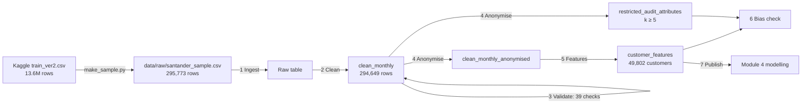

# Data Pipeline

Orchestrated by Prefect (`flows/pipeline_flow.py`). Each stage is a Prefect task; a failed validation stops the run before any output is written.

## Stages and lineage



## Data sources and outputs

| Name | Type | Format | Frequency | Rows |
| --- | --- | --- | --- | --- |
| Santander Product Recommendation (proxy) | Customer snapshots | CSV | Monthly | 295,773 (6 months, 50,000 customers) |
| `customer_features` | Analysis table for Module 4 | Parquet | Each run | 49,802 |
| `clean_monthly_anonymised` | Monthly history | Parquet | Each run | 294,649 |
| `restricted_audit_attributes` | Protected attributes for bias checks | Parquet | Each run | 294,649 |
| `reports/bias/` | Representation report and chart | CSV, PNG | Each run | 12 groups |
| `logs/audit_log.jsonl` | Privacy audit log | JSON lines | Every access | One entry per stage |

## Cleaning results (real run, 2016-05 sample)

| Issue | Rows affected | Rule |
| --- | --- | --- |
| Bank employees | 126 removed | Not retail customers |
| Deceased customers | 778 removed | Cannot be targeted |
| Age over 100 | 220 removed | Data error |
| Minors (junior accounts) | kept | Valid customers |
| Income missing | 69,587 filled | Overall median, plus `income_was_missing` flag |
| Income above 99th percentile | 2,250 capped | Cap at 536,957 |
| Duplicate customer-months | 0 | Checked on every run |
| Text numbers with spaces (age, tenure, activity) | all rows | Stripped and converted |

## Run it

```bash
pip install -r requirements-pipeline.txt
set ANON_SALT=choose-a-long-secret        # PowerShell: $env:ANON_SALT="..."
python -m flows.pipeline_flow
pytest -q
```
